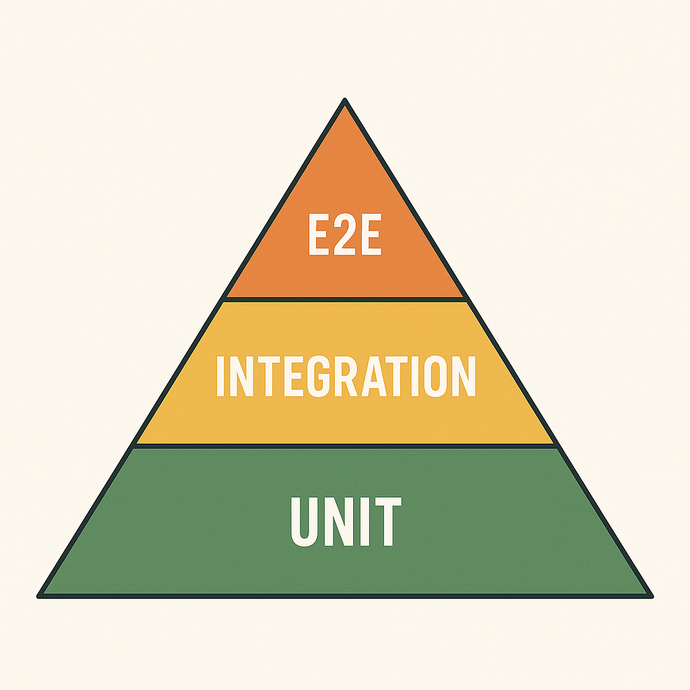

<h1>
  <span class="headline">Understanding the Testing Landscape and Tools of Python</span>
  <span class="subhead">Understanding Different Types of Software Tests</span>
</h1>

**Learning Objective:**  
Differentiate between unit, integration, and end-to-end tests by describing their purpose, scope, and typical use cases within the software development lifecycle.

## The testing pyramid

Developing reliable software involves not just writing code, but _testing_ it in meaningful ways. One widely-used model for understanding software testing strategies is the _testing pyramid_.

Imagine a triangle divided into three layers:

- **Base:** _Unit tests_
- **Middle:** _Integration tests_
- **Top:** _End-to-end (E2E) tests_

The widest part of the pyramid—the foundation—is composed of many unit tests. As you work your way up, you add fewer integration and even fewer E2E tests.

> 💡 The pyramid helps you visualize a balanced approach: focusing on fast, low-cost tests (unit) at the bottom, and using smaller numbers of slower, more complex tests (integration, E2E) at the top.



### Why stack the pyramid this way?

- **Cost and Speed:**  
  Unit tests are quick to run and write, while E2E tests are more involved and take longer to execute.
- **Scope:**  
  Unit tests check code in isolation. Integration tests check components working together. E2E tests simulate a user’s interaction with the entire system.

Building test suites according to this pyramid leads to faster feedback, fewer maintenance issues, and higher confidence in your code.

## Unit tests

_Unit tests_ examine single pieces of your code—such as a function or a method—without involving other parts of your application.

### Where do unit tests fit in your workflow?

Suppose you have a reusable function that calculates a discount on a product’s price. You want to guarantee it always returns the right result, regardless of how or where it’s used in your application.

<code class="filepath">tests/test_discount.py</code>

```python
def calculate_discount(price, percent):
    return price * (1 - percent / 100)

def test_calculate_discount():
    # Arrange: set up example inputs
    price = 100
    percent = 15
    # Act & Assert: check that the result is correct
    assert calculate_discount(price, percent) == 85
```

> 🏆 Unit tests provide immediate feedback—when this function changes in the future, you will quickly know if you accidentally broke its logic.

**Typical use cases:**

- Checking calculations or algorithms (totals, averages, discounts).
- Verifying data transformations.
- Testing simple business logic decisions.

## Integration tests

_Integration tests_ make sure that different parts of your application work together as intended.

### Where do integration tests fit in your workflow?

Imagine your FastAPI app has a feature where users register, and upon registration, their information is saved in a database. Here, you care about the interaction—not just whether saving to the database works, or the registration logic works alone, but whether they work _together_.

<code class="filepath">tests/test_user_registration.py</code>

```python
def test_user_registration(client, test_db):
    # Arrange: prepare test data
    user_info = {"username": "samira", "password": "securepass123"}
    # Act: submit registration via API
    response = client.post("/register", json=user_info)
    # Assert: check response and database
    assert response.status_code == 201
    users = test_db.get_all_users()
    assert any(u["username"] == "samira" for u in users)
```

> 🧠 Integration tests are critical for systems where parts rely on each other. They often reveal problems that unit tests cannot catch, like mismatched data formats or overlooked setup steps.

**Typical use cases:**

- Ensuring APIs return correct data after querying a database.
- Verifying that messaging services or email notifications are triggered appropriately.
- Testing workflows that span several interconnected modules.

## End-to-end tests

_End-to-end (E2E) tests_ simulate a user’s complete journey through your application—often using tools that operate in the same way a human would interact with your product.

### Where do E2E tests fit in your workflow?

If you build a web application where users sign up, log in, shop for items, and check out, an E2E test might follow this whole process from start to finish using an automated browser.

<code class="filepath">tests/test_checkout_e2e.py</code>

```python
from selenium import webdriver

def test_checkout_process():
    browser = webdriver.Firefox()
    try:
        browser.get("http://localhost:8000")
        # Simulate actions: sign in, add to cart, purchase
        browser.find_element("id", "button-login").click()
        browser.find_element("id", "field-username").send_keys("alex")
        browser.find_element("id", "field-password").send_keys("passw0rd!")
        browser.find_element("id", "button-submit-login").click()
        browser.find_element("id", "button-add-item").click()
        browser.find_element("id", "button-checkout").click()
        assert "Thank you for your purchase" in browser.page_source
    finally:
        browser.quit()
```

> 💡 E2E tests show you if _everything_—from user interface to backend to data storage—works together as expected from a user’s perspective.

**Typical use cases:**

- Confirming a user can complete registration, login, and checkout workflows.
- Testing complex interactions and error scenarios (such as forgotten password flows).
- Validating that real browsers or devices display the application correctly.

## Comparing the three types

| Test type        | Purpose                             | Scope                     | Example use case           | Cost & speed    |
| ---------------- | ----------------------------------- | ------------------------- | -------------------------- | --------------- |
| Unit test        | Check a single function or class    | Code in isolation         | Validate price calculation | Fast, low cost  |
| Integration test | Check cooperation of components     | Multiple modules/services | API saves to database      | Medium          |
| End-to-end (E2E) | Simulate user flow across whole app | Full system               | User completes checkout    | Slow, high cost |

> ♻️ A healthy project balances all three types, using unit tests for most scenarios, integration tests for key connections, and E2E tests for critical workflows.

<div class="activity solo-exercise">
  <h2 class="title">Identify and classify software test scenarios</h2>
  <span class="minutes">5 min</span>
</div>

Let’s practice distinguishing between the main types of tests using scenarios you might encounter as a Python developer.

1. **Read the Scenarios**

   - **Scenario A:**  
     You are testing a function that accepts a list of numbers and returns their average. You verify the output using different sets of input values.
   - **Scenario B:**  
     You simulate submitting a login form in a web browser and check that the user is redirected to the dashboard page after logging in.
   - **Scenario C:**  
     You test your API’s ability to add a new user to a database and confirm that the user appears in the response when retrieving the list of all users. This test uses a real test database.

2. **Classification**
   For each scenario:

   - What is the scope—just one function, several modules, or the entire system?
   - Which technologies are involved—just Python code, or also a database, browser, or an API endpoint?
   - Based on your answers, classify each scenario as a unit, integration, or end-to-end test.

3. **Reflection**

   - In your own coding experience (in Python or another language), which type of test do you write most often? Which do you feel least confident about?
